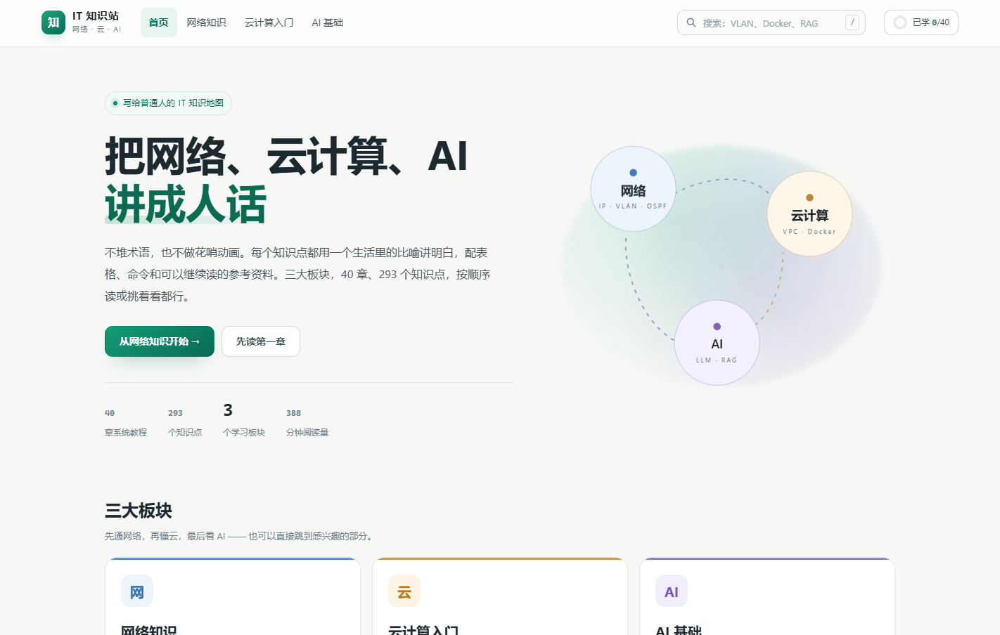
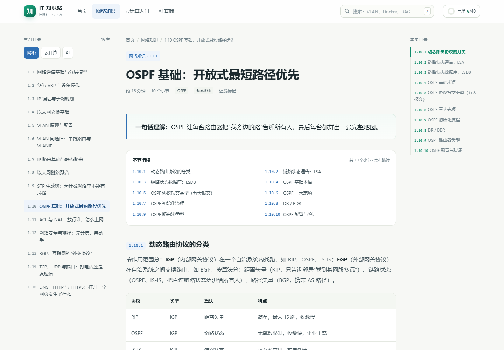

# IT 知识站 · 网络 / 云计算 / AI

> 写给普通人的 IT 知识地图：**3 个板块、40 章、293 个知识点**。纯静态、零依赖，双击 `index.html` 就能看。





## 这是什么

一个按教材层级组织的 IT 学习站：板块 → 章（如 1.10）→ 小节（如 1.10.1）。每个小节先用一句人话讲清楚，再配表格、命令、生活类比和常见误区，适合零基础入门，也适合拿来复习和查漏补缺。

- **网络知识**：15 章 / 112 个知识点
- **云计算入门**：13 章 / 93 个知识点
- **AI 基础**：12 章 / 88 个知识点

## 特点

- 文档式三栏布局：顶部导航 + 左侧章节目录 + 正文 + 右侧本页目录，参考菜鸟教程的阅读结构
- 每章自动生成「本节结构」，编号从 1.10.1 到 1.10.10，点击即可跳转
- 板块页有「知识地图」，可以展开每章查看全部小节，先看框架再抠细节
- 顶部搜索支持标题、正文、标签和命令，快捷键 `/`
- 「标记为已学会」保存到浏览器 localStorage，顶部进度条实时更新
- 代码块一键复制、手机端目录抽屉、支持打印
- 纯 HTML/CSS/原生 JS，没有构建工具、没有后端、没有 npm 依赖，可直接部署到 GitHub Pages

## 课程结构

### 1. 网络知识（15 章）

1.1 网络通信基础与分层 · 1.2 华为 VRP 与设备操作 · 1.3 IP 编址与子网规划 · 1.4 以太网交换基础 · 1.5 VLAN 原理与配置 · 1.6 VLAN 间通信（单臂路由 / VLANIF） · 1.7 IP 路由基础与静态路由 · 1.8 以太网链路聚合 · 1.9 STP 生成树 · **1.10 OSPF 基础（10 个小节）** · 1.11 ACL 与 NAT · 1.12 网络安全与排障 · 1.13 BGP · 1.14 TCP/UDP 与端口 · 1.15 DNS/HTTP/HTTPS

### 2. 云计算入门（13 章）

2.1 云计算概念与服务模式 · 2.2 虚拟化与 FusionCompute · 2.3 服务器与 BMC · 2.4 存储虚拟化与 RAID · 2.5 VPC / 安全组 / 负载均衡 · 2.6 Linux 常用命令 · 2.7 Docker · 2.8 Kubernetes · 2.9 FusionAccess 桌面云 · 2.10 高可用 / 备份 / 容灾 · 2.11 云安全与运维 · 2.12 上云迁移与成本 · 2.13 OpenStack 与 HCS

### 3. AI 基础（12 章）

3.1 AI/ML/DL/LLM 全景 · 3.2 机器学习范式与评估 · 3.3 数据与特征 · 3.4 神经网络与反向传播 · 3.5 Transformer 与注意力 · 3.6 大语言模型 · 3.7 提示词工程 · 3.8 RAG · 3.9 微调与 LoRA · 3.10 Agent 与 Harness · 3.11 多模态与应用 · 3.12 安全、伦理与评估

## 目录结构

```
.
├── index.html            # 页面骨架：顶部栏、侧边栏、正文区、右侧目录
├── css/
│   └── style.css         # 浅色文档风 + 三板块主题色 + 移动端
├── js/
│   ├── data-network.js   # 网络 1.1 - 1.4
│   ├── data-network-2.js # 网络 1.5 - 1.8
│   ├── data-network-3.js # 网络 1.9 - 1.10（STP / OSPF）
│   ├── data-network-4.js # 网络 1.11 - 1.12（ACL/NAT / 排障）
│   ├── data-network-5.js # 网络 1.13 - 1.15（BGP / TCP / DNS）
│   ├── data-cloud.js     # 云计算 2.1 - 2.4
│   ├── data-cloud-2.js   # 云计算 2.5 - 2.8
│   ├── data-cloud-3.js   # 云计算 2.9 - 2.12
│   ├── data-cloud-4.js   # 云计算 2.13
│   ├── data-ai.js        # AI 3.1 - 3.4
│   ├── data-ai-2.js      # AI 3.5 - 3.8
│   ├── data-ai-3.js      # AI 3.9 - 3.12
│   └── app.js            # 渲染、编号、路由、搜索、进度、目录高亮
├── docs/
│   ├── preview.png       # README 首页截图
│   └── ospf.png          # README 章节截图
├── README.md
├── LICENSE
└── .gitignore
```

## 本地查看

**直接双击 `index.html`** 就能打开，不需要服务器。

想用本地服务器：

```bash
python -m http.server 8000
# 打开 http://127.0.0.1:8000/
```

## 部署到 GitHub Pages

1. 新建一个 GitHub 仓库，把本目录的**所有文件**上传到仓库根目录（保持 `index.html` 在根目录）。
2. 打开仓库的 **Settings → Pages**。
3. Source 选择 **Deploy from a branch**，Branch 选 **main**，目录选 **/(root)**，保存。
4. 等 1–2 分钟，访问 `https://<你的用户名>.github.io/<仓库名>/`。

站点全部使用相对路径，放在仓库子路径下也能正常加载。

## 编号规则与添加内容

- 板块编号：网络 = 1，云计算 = 2，AI = 3
- 章编号：按每个板块内的顺序自动生成，如网络第 10 章 = `1.10`
- 小节编号：按章内 `h3` 的出现顺序自动生成，如 `1.10.1`、`1.10.2`
- 新增/删除章节后，首页统计、左侧目录、搜索索引、知识地图会自动更新

在对应 `js/data-*.js` 的 `chapters` 里加一项：

```js
{
  id: 'net-16',
  title: '新章节标题',
  lead: '一句话理解',
  minutes: 8,
  tags: ['标签'],
  blocks: [
    { t: 'h3', text: '小节标题' },                 // 自动变成 1.16.1
    { t: 'p', html: '正文，支持 <strong>加粗</strong> 和 <code>代码</code>' },
    { t: 'ul', items: ['要点一', '要点二'] },
    { t: 'table', head: ['列1', '列2'], rows: [['a', 'b']] },
    { t: 'note', tone: 'tip', title: '生活类比', html: '……' },
    { t: 'code', lang: 'bash', title: '命令', code: 'ls -lh' },
    { t: 'links', items: [{ label: '参考', url: 'https://…' }] }
  ]
}
```

支持的 block：`h3`、`p`、`ul`、`table`、`note`（tip / warn / key）、`code`、`cards`、`flow`、`links`。

## 内容来源与声明

内容以**华为 HCIA/HCIP/HCIE 云计算课程大纲**和**华为 Datacom 课程大纲**为骨架，参考 [菜鸟教程](https://www.runoob.com/) 的 TCP/IP、HTTP、Linux、Docker、AI 教程，以及 Kubernetes 官方文档、相关论文等公开资料，全部用大白话重新撰写。

- 本项目是个人学习笔记，**与华为、菜鸟教程等机构没有隶属关系**
- 仓库不包含任何厂商课件原文、课程视频或受版权保护的培训资料
- 示例命令（华为设备、Linux、Docker、kubectl）请在测试环境验证，生产操作前先备份
- 引用的外部链接版权归原作者所有；如果内容有误，欢迎提 Issue 指正

## 学习进度

「标记为已学会」使用浏览器 `localStorage`，key 为 `it-study-progress-v2`。进度只保存在本机，换设备不会同步；清除浏览器数据会重置。

## License

代码以 [MIT](LICENSE) 协议开源。文章内容为个人学习整理，转载请注明出处；引用资料的版权归原作者。
